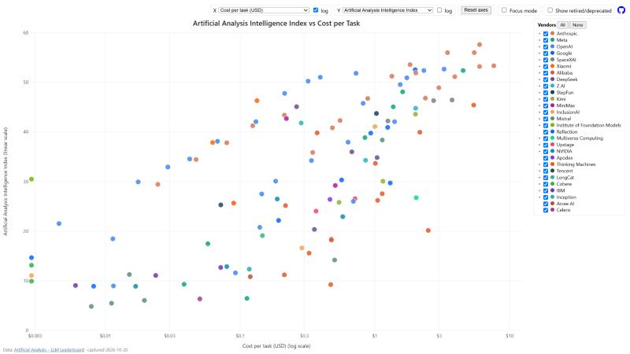
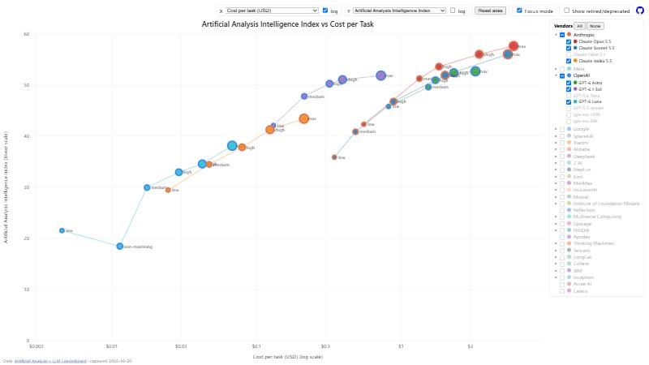

# AI Model Explorer

An interactive, fullscreen scatter plot of the
[Artificial Analysis LLM leaderboard](https://artificialanalysis.ai/leaderboards/models).
By default it plots the Intelligence Index against cost per task (log scale).

**▶ [Open the explorer](https://xavierhd.github.io/AI-model-explorer/)**
· [This README on GitHub](https://github.com/xavierhd/AI-model-explorer#readme)

[](https://xavierhd.github.io/AI-model-explorer/)

Focus mode on the Anthropic and OpenAI latest families:

[](https://xavierhd.github.io/AI-model-explorer/)

## Usage

Use the [hosted page](https://xavierhd.github.io/AI-model-explorer/), or open `index.html`
locally in a browser. A double-click works, and no server is needed.

- **Hover** a point to see the model's details. When points overlap, every model under the cursor is listed.
- **X / Y**: choose any numeric column of the expanded leaderboard table, and set each axis to log or linear.
- **⇄ Swap axes**: exchange X and Y. Each column keeps its log/linear setting.
- **Reset axes**: go back to cost per task (log) against intelligence. Vendor and model selection is kept.
- **Vendors legend**: turn vendors on or off, or use All / None. Click ▸ to show a vendor's model families
  (e.g. Haiku, Sonnet, Opus) and turn them on or off one by one. Vendors and families with no data
  for the chosen columns are hidden.
- **Focus mode**:
  - Points are colored by model family and ringed in their vendor's color.
  - Size and label show the thinking level.
  - Each family's points are joined by a line.
- **Show retired/deprecated** draws models the leaderboard deprecated or no longer lists, hollow with a
  dashed outline. They keep their last known values, and their tooltip warns that those may not be
  comparable with current models.

On phones (width up to 700px), tap a point to see its details, and open the vendor list with the
**Vendors** button.

All settings are saved in the browser (localStorage) and restored when the page is reopened.

## Refreshing the data

```bash
python refresh_aa_data.py
```

This downloads the leaderboard and merges it into `aa-data.js`. Python 3 is required, using only the
standard library. Options:

| Option | Purpose |
| --- | --- |
| `--input page.html` | Use a saved copy of the page instead of downloading it |
| `--output file.js` | Merge into another file |
| `--date YYYY-MM-DD` | Capture date (when replaying a saved page) |

Merging keeps history. Models are identified by their `slug`, and models the page no longer has
scores for are kept with their last known values. Each model carries:

| Field | Meaning |
| --- | --- |
| `firstSeen` | Capture date the model first appeared |
| `lastSeen` | Last capture date the page gave its scores |
| `deprecated` / `deprecationDate` | Flagged deprecated by the site / first capture seen as such |
| `retired` / `retiredDate` | No longer listed by the site at all / first capture found missing |

The live page only carries scores for current models, so **`aa-data.js` is the only copy of older
models' scores**. Back it up, or keep it under version control.

## Files

| File | Content |
| --- | --- |
| `index.html` | Page structure |
| `aa-plot.js` | Chart, legend, tooltip and state (plain JavaScript, no libraries) |
| `aa-plot.css` | Styles |
| `aa-data.js` | Data: `window.AA_DATA = { source, capturedAt, notes, columns, models }`, generated |
| `refresh_aa_data.py` | Data refresh script |

Data © Artificial Analysis.
